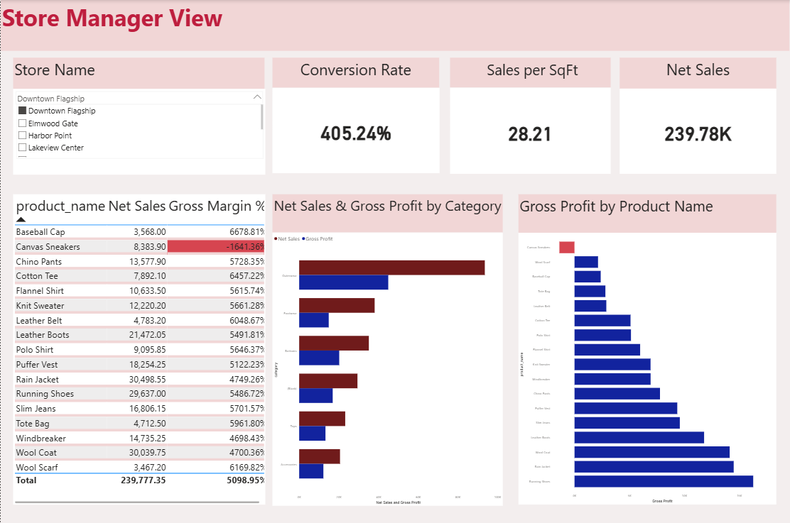
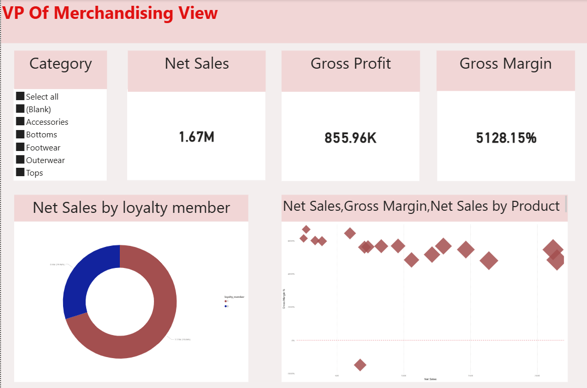
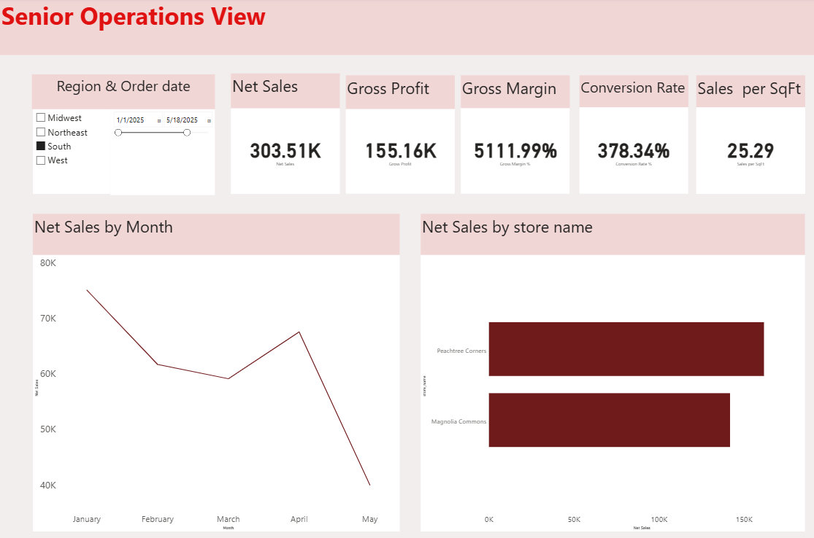

# Retail Apparel Analysis

## Overview
This repository contains an end-to-end analytics project exploring retail store and apparel performance. The analysis is supported by comprehensive data models, KPIs, and visual dashboards designed to answer critical operational and strategic questions.

---

## 🔍 Key Business Questions Addressed
This project provides data-driven answers to the following core questions:
1. **Store Performance:** How would you assess overall store performance?
2. **Trend Analysis:** What distinguishes a genuine underlying problem from a temporary bad month?
3. **Promotions:** How effective have the promotions been?
4. **SKU Optimization:** Are there any SKUs you would recommend discontinuing or repricing?
5. **Pricing Strategy:** Are we priced competitively against the market in each category, and where should we adjust?
6. **Loyalty Program:** Is the loyalty programme delivering value?
7. **Customer Behavior:** What can you conclude about customer conversion rates?
8. **Inventory Management:** Which SKUs appear to be under-stocked or over-stocked?
9. **Geographic Distribution:** How is store allocation distributed geographically?
10. **Management Evaluation:** How will you evaluate the performance of store managers?

---

## 📊 Dashboard Architecture & Target Audiences
A single, cohesive Power BI dashboard (`Retail Apparel Analysis.pbix`) was built to present tailored data views for three distinct key audiences:

1. **Store Manager**
    A concise, five-minute Monday-morning overview focused on immediate, actionable insights.
2. **VP of Merchandising**
    Deep-dive data and insights necessary to evaluate whether past promotions should be repeated.
3. **Senior Merchandising / Operations Manager**
    A broader, strategic view reflecting overall business performance and long-term trends.

Each view was meticulously designed with its specific audience's priorities, time constraints, and decision-making needs in mind.

## 📊 Dashboard Previews

Below are previews of the Power BI dashboard views tailored for each key stakeholder:

### 1. Store Manager View
*A concise overview focused on immediate, actionable store-level metrics and product performance.*

  

### 2. VP of Merchandising View
*Deep-dive insights evaluating category performance, loyalty metrics, and margins.*

  

### 3. Senior Operations View
*A strategic view tracking regional trends, monthly performance, and conversion rates.*

  

---

## 📂 Repository Contents
* `README.md`: Project documentation and overview.
* `Retail Apparel Analysis.pbix`: Interactive Power BI dashboard file.
* `Retail_Apparel_Analysis.ipynb`: Colab Notebook containing the data preparation, transformation, and analytical code.
